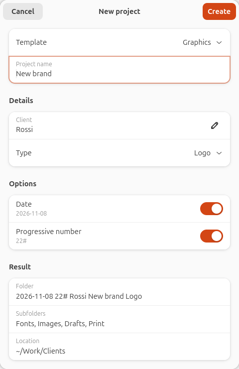
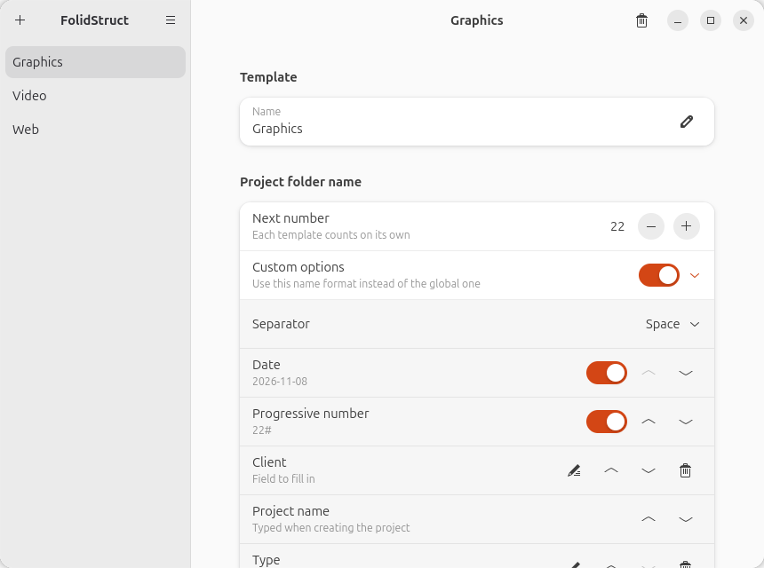

<p align="center">
  
</p>

<h1 align="center">FolidStruct</h1>

<p align="center">
  Create project folder structures from templates, right from your file
  manager's context menu.
</p>

<p align="center">
  
</p>

Define a template once — say *Graphics* with `Fonts`, `Images`, `Drafts`,
`Print` — then right-click any folder, choose **FolidStruct ▸ Graphics**, type the
project name and get:

```
2026-11-07 22# Rossi New brand Logo/
├── Fonts/
├── Images/
├── Drafts/
└── Print/
```

Every project gets the same folder names, so your archive stays consistent.

## Features

- Any number of templates, each with its own list of folders.
- A project folder name built from blocks you can reorder:
  - **date** in ISO format (`2026-11-07`);
  - **progressive number** followed by `#` (`22#`), counted separately for
    each template;
  - the **project name**;
  - your own blocks: **fixed text** (e.g. a studio code), **fields** to fill
    in (e.g. *Client*) and **choices** from a list (e.g. *Type: Logo,
    Brochure, Web*), so names stay consistent. Empty blocks are skipped.
- Blocks joined by a space, `_`, `-` or ` - `.
- Settings at three levels:
  1. **global** name format, in Preferences;
  2. **per template**, by enabling *Custom options*;
  3. **per project**, in the dialog shown when creating it.
- Existing folders are never overwritten or merged.
- Works with GNOME Files (Nautilus), Nemo, Caja and Dolphin.
- GTK 4 / libadwaita interface in English and Italian: it follows the
  system language, or can be chosen in Preferences. The example template is
  translated too, as long as you have not edited it.

## Requirements

FolidStruct needs **Python 3.10+, GTK 4 and libadwaita 1.5+**, which ship with:

| Distribution              | Supported from |
|---------------------------|----------------|
| Ubuntu and flavours       | 24.04          |
| Debian                    | 13 (trixie)    |
| Fedora                    | 40             |
| Linux Mint                | 22             |
| Arch, openSUSE Tumbleweed | current        |

The context menu also needs your file manager's extension support:

| File manager            | Version | Package (Debian/Ubuntu · Fedora · Arch)                    |
|-------------------------|---------|------------------------------------------------------------|
| GNOME Files (Nautilus)  | 43+     | `python3-nautilus` · `nautilus-python` · `python-nautilus` |
| Nemo (Cinnamon)         | any     | `nemo-python` · `nemo-python` · `nemo-python`              |
| Caja (MATE)             | any     | `python3-caja` · `python3-caja` · `python-caja`            |
| Dolphin (KDE Plasma)    | 6       | nothing extra                                              |

In GNOME Files, Nemo and Caja the menu lists your templates. In Dolphin it
shows **FolidStruct ▸ New project…** and you pick the template in the dialog; its
labels follow the system language rather than the one chosen in FolidStruct.

Other file managers (e.g. Thunar) are not supported yet, but FolidStruct can always
be used from the command line.

On the Ubuntu desktop the menu is not available: desktop icons are drawn by a
GNOME Shell extension (Desktop Icons NG), not by GNOME Files, and it does not
load file manager extensions. Right-click the desktop, choose **Show Desktop in
Files** and use the menu there.

## Install

If you previously installed FolidStruct with `install.sh`, run `./uninstall.sh`
before installing a package, or the menu entry will appear twice.

### Ubuntu, Debian, Linux Mint

Download the `.deb` file from the
[latest release](https://github.com/rem2608/folidstruct/releases/latest)
and open it, or:

```bash
sudo apt install ./folidstruct_*.deb
```

### Any distribution, current user only

No root needed; everything goes under `~/.local`:

```bash
git clone https://github.com/rem2608/folidstruct.git
cd folidstruct
./install.sh
```

`install.sh` checks the requirements and tells you what is missing.
To remove it, run `./uninstall.sh` (your templates are kept).

### From source, system-wide

```bash
meson setup build --prefix=/usr
meson test -C build
sudo meson install -C build
```

Options `-Dnautilus=false`, `-Dnemo=false`, `-Dcaja=false` and
`-Ddolphin=false` skip the corresponding integration.

After installing, restart your file manager (e.g. `nautilus -q`).

## Usage

- **Manage templates:** open *FolidStruct* from the applications menu, or choose
  **FolidStruct ▸ Manage templates…** in the context menu.
- **Create a project:** in the file manager, right-click a folder or the
  empty space inside one, then choose **FolidStruct ▸ *template***.

<p align="center">
  
</p>

Command line:

```bash
folidstruct                                          # open the template manager
folidstruct --new Graphics --dir ~/Work              # ask for the name, then create
folidstruct --new Graphics --name "Logo" --dir ~/Work  # create without asking
```

Templates and options are stored in `~/.config/folidstruct/`; the
progressive numbers in `counters.json`, next to them.

## Development

```bash
python3 -m folidstruct            # run from the source tree
python3 -m unittest -v     # run the tests
```

- `folidstruct/core.py` — configuration, naming and folder creation (no GTK).
- `folidstruct/manager.py`, `folidstruct/newproject.py` — the two windows.
- `folidstruct/i18n.py` — translations: add a dictionary for your language code.
- `extensions/folidstruct_menu.py` — context menu for Nautilus, Nemo and Caja
  (they share the same Python extension API).
- `data/` — desktop entry, icons, AppStream metadata, Dolphin service menu.
- `debian/` — Debian/Ubuntu package, built by GitHub Actions on release.
- `packaging/aur/PKGBUILD` — an unpublished starting point for an Arch
  package; anyone is welcome to maintain it on the AUR.

### Releasing

1. `scripts/set-version.sh 1.2.3` updates the version everywhere; edit the
   release notes in `debian/changelog` and the metainfo file.
2. Commit, then tag and push: `git tag v1.2.3 && git push --tags`.
   GitHub Actions builds the `.deb` and publishes the release.

## Windows

A Windows version, with the same templates and a FolidStruct submenu in
the File Explorer context menu (including the Windows 11 menu), is in
development in [`windows/`](windows/README.md) and will be published in
the Microsoft Store.

## Credits

FolidStruct was designed by [rem2608](https://github.com/rem2608) and
developed with the help of [Claude](https://claude.ai) (Anthropic).

## License

GPL-3.0-or-later. See [LICENSE](LICENSE).
